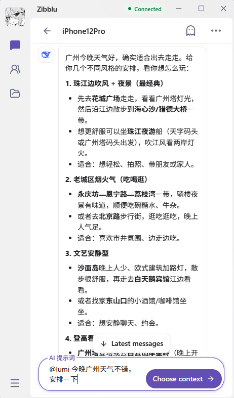

<div align="center">


# Zibblu

**Chat freely. Share privately.**

A calm place for conversations, files, and private moments.

[**Download for Windows**](https://download.openurain.com/zibblu/windows/v0.1.10/Zibblu_0.1.10_x64_Client_Setup.exe) · [Website](https://zibblu.openurain.com/) · [简体中文](README.zh-CN.md)

</div>


## Made for the conversations that matter

| Everyday chat | Share without friction | Private when it matters |
| --- | --- | --- |
| Direct and group messages, with history saved on your device. | Send files and folders, resume downloads, and verify file integrity. | Start a separate, consent-based encrypted text session with devices on your LAN. |

<table>
<tr>
<td width="50%"></td>
<td width="50%"></td>
</tr>
<tr><td><sub>Comfortable at smaller window sizes.</sub></td><td><sub>Private LAN mode, separate from ordinary history.</sub></td></tr>
</table>

### Your chats, on your terms

- **Local-first history.** Messages received by a device are kept in its local SQLite profile, so saved history stays readable offline.
- **Reliable sharing.** File transfers can resume after interruption and completed downloads are integrity-checked.
- **Private LAN chat.** An opt-in, encrypted direct text connection between verified devices on an allowed local network. No internet relay or fallback.
- **Read-only AI.** Ask configured assistants about only the ordinary-chat messages and files you explicitly authorize for a request. Private LAN content is excluded.

> **Privacy, accurately:** ordinary chats travel through the selected online server, which can access messages and attachments during delivery; they are **not end-to-end encrypted**. Private LAN text uses a different direct channel. Ending a private session clears the app-managed transcript, but cannot remove screenshots or OS traces. [Read the security boundaries](docs/SECURITY.md).

## Get Zibblu

**Windows 10 / 11 · x64** — [Download v0.1.10 installer](https://download.openurain.com/zibblu/windows/v0.1.10/Zibblu_0.1.10_x64_Client_Setup.exe) · [SHA-256 checksums](https://download.openurain.com/zibblu/windows/v0.1.10/SHA256SUMS.txt) · [GitHub Release](https://github.com/openUrain/Zibblu/releases/tag/v0.1.10)

Run the installer, open Zibblu, and sign in or create an account on **Zibblu Online**. To use your own compatible server, choose **Advanced** at sign-in and enter its HTTPS address. The installer is unsigned and may install Microsoft WebView2 when required. Verify the download using the published checksum.


## Run your own server

Deploy **Zibblu Online + PostgreSQL** using Docker Compose. Your team connects to your HTTPS server; ordinary chat delivery stays on that infrastructure.

[**Self-hosting guide**](docs/ONLINE_DEPLOYMENT.md#enterprise-self-hosting) · [Architecture](docs/ARCHITECTURE.md) · [Product behavior](docs/PRODUCT.md)

## Develop

The desktop client uses **Tauri 2 / React / TypeScript**; the core and online service use **Rust**, with PostgreSQL for the service and SQLite on clients.

```powershell
# From the repository root, with a local PostgreSQL database:
$env:DATABASE_URL = 'postgres://zibblu:<password>@127.0.0.1:5432/zibblu'
cargo run --locked -p zibblu-online
```

```powershell
# In a separate terminal:
cd apps/desktop
npm ci
npm run tauri dev
```

Requires Rust, Node.js and the [Tauri prerequisites](https://v2.tauri.app/start/prerequisites/). For builds, local-network configuration and mobile testing, see the [deployment guide](docs/ONLINE_DEPLOYMENT.md), [roadmap](docs/ROADMAP.md), [Windows/iOS workflows](.github/workflows), and [contributing rules](AGENTS.md).

---

<div align="center">
<sub>Built by <a href="https://openurain.com/">openUrain</a> · <a href="docs/SECURITY.md">Security</a> · <a href="docs/DESIGN_SYSTEM.md">Design system</a></sub>
</div>
