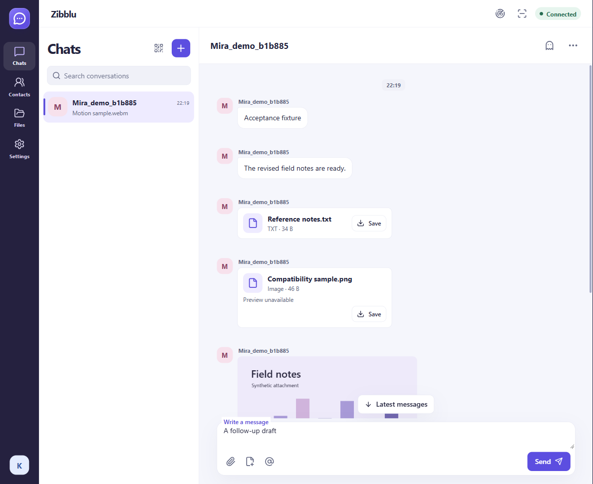
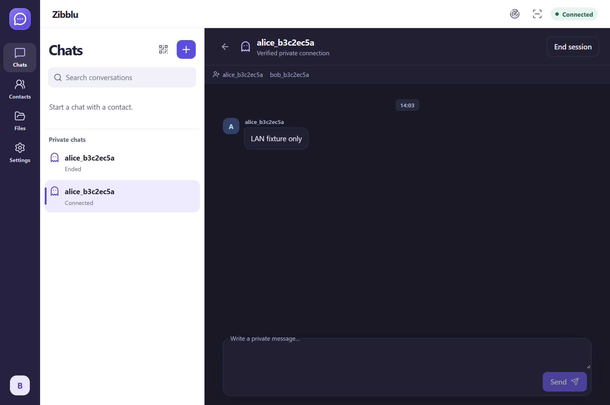
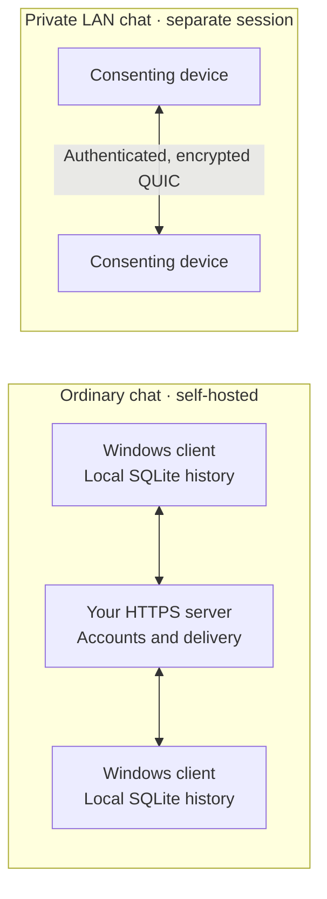

# Zibblu

**Chat freely. Share privately.**

[](https://github.com/openUrain/Zibblu/releases/tag/v0.1.4)
[](#enterprise-self-hosting)
[](#private-lan-chat)
[](https://github.com/openUrain/Zibblu/actions/workflows/ci.yml)

Zibblu is a Windows messenger with **enterprise self-hosting** and a separate **private LAN chat** mode. Keep received chat history on your device, share files that can resume after an interruption, and choose exactly what an AI assistant can read.

[Download for Windows x64](https://github.com/openUrain/Zibblu/releases/download/v0.1.4/Zibblu_0.1.4_x64_Client_Setup.exe) · [Product website](https://zibblu.openurain.com/) · [Deploy your own server](docs/ONLINE_DEPLOYMENT.md#enterprise-self-hosting)



*Windows client captured during [file-sharing testing](https://github.com/openUrain/Zibblu/issues/35).*

## Enterprise Self-Hosting

Run **Zibblu Online** and PostgreSQL on infrastructure your organization controls. In the Windows client, open **Advanced** on the sign-in screen and enter your organization’s HTTPS server address. Ordinary chats and attachments between accounts on that server are delivered through it, without going through the official Zibblu server.

The hosting server authenticates accounts and handles delivery. It can read ordinary messages and files during online availability. Ordinary chats use HTTPS for transport and have **no end-to-end encryption**. [Docker Compose deployment guide](docs/ONLINE_DEPLOYMENT.md#enterprise-self-hosting)

## Private LAN Chat

Start a separate text session with participants on a reachable local network. Participants opt in, and devices verify each other over an encrypted QUIC connection. Private messages have **no server relay or internet fallback**. When the session ends, Zibblu discards its in-memory conversation and leaves no private transcript in app history. Screenshots, recipient copies and OS-level traces are outside that cleanup.

The account service issues device credentials used to verify identities. Private messages travel directly between clients. [Private LAN security boundaries](docs/SECURITY.md#private-lan-sessions)



*Windows client captured during [private-chat testing](https://github.com/openUrain/Zibblu/issues/26).*

### How messages travel



## Everyday chat, files and AI

| Feature | What you can do |
| --- | --- |
| **Local-first history** | Read received ordinary messages from the current device’s SQLite history, including when an active session goes offline. Text and staged attachments can queue for reconnection. A new device can receive eligible pending deliveries and new messages. |
| **File sharing** | Send files and folders, find shared attachments, and pause or resume transfers. Completed downloads are checked against their SHA-256 digest. Online attachment availability follows the server’s policy. |
| **Read-only AI** | In an ordinary chat, mention a configured assistant, review the provider and choose which messages and optional text files to send for that request. Cloud AI has no access to private LAN chats. |

## Install Zibblu on Windows

1. On Windows 10 or 11 x64, run the installer from the [v0.1.4 release](https://github.com/openUrain/Zibblu/releases/tag/v0.1.4). Verify the installer against the published SHA-256 checksum. The installer is unsigned and can install Microsoft WebView2 if needed.
2. Start Zibblu. A fresh profile defaults to **Zibblu Online**. To use your organization’s compatible v2 service, select **Advanced** and enter its HTTPS origin without a path. Local development also supports `http://127.0.0.1:7841`.
3. Create an account or sign in on that server. Find a friend by username in **Contacts** and send a request. Once accepted, start a chat and share files.

v0.1.4 uses separate Local-First profiles. Old test accounts need to register again on the v2 official service. The client remembers the most recent successful server selection, and profiles are scoped to a server and account.

## Development and self-hosting

[Deploy `zibblu-online` with Docker Compose.](docs/ONLINE_DEPLOYMENT.md#enterprise-self-hosting)

Install Rust 1.90 or newer, Node.js 22.12 or newer, PostgreSQL, and the [Tauri Windows prerequisites](https://v2.tauri.app/start/prerequisites/#windows). Use a Visual Studio x64 developer terminal to load MSVC and the Windows SDK. Create an empty PostgreSQL database owned by a dedicated Zibblu database user. From the repository root, start the service with that user's connection string.

```powershell
$env:DATABASE_URL = 'postgres://zibblu:<password>@127.0.0.1:5432/zibblu'
cargo run --locked -p zibblu-online
```

In another terminal, run the desktop app.

```powershell
cd apps/desktop
npm ci
npm run tauri dev
```

Open **Advanced**, enter `http://127.0.0.1:7841`, and create a test account. For remote users, terminate HTTPS at a reverse proxy in front of the loopback service and give both clients the same HTTPS origin. Configure rate limiting for login and registration before public access and keep the database reachable only by trusted services.

Use the paperclip, folder button, drag and drop, or paste an image into the composer. Folders arrive as ZIP archives. Use the conversation's **…** drawer for **Search chat** and **Shared files**. The sidebar **Files** workspace lists ordinary attachments by time, with filename search and transfer controls. Look for previewable images and videos in the conversation’s media history. Save a download to an unused filename. If a transfer pauses or fails, choose **Resume** or **Retry** to continue.

For two independent local profiles, launch the Windows executable with a different `ZIBBLU_DATA_DIR` in each process. By default, the app uses its Windows local app data directory. Launching again with the same directory brings back its existing window.

### Build and check the Windows client installer

From an x64 developer terminal in `apps/desktop`, run:

```powershell
npm ci
npm run tauri build -- --bundles nsis --target x86_64-pc-windows-msvc -- --locked
```

The build writes the setup executable to `target/x86_64-pc-windows-msvc/release/bundle/nsis`. The published v0.1.4 asset is named `Zibblu_0.1.4_x64_Client_Setup.exe`. The installer preserves the existing Windows installer identity and defaults to the data directory `%LOCALAPPDATA%\com.zibblu.desktop`, separate from the installed executable.

On a clean Windows 10 or 11 system, install and sign in with a test account. Change the theme, open a normal chat and save an attachment. Minimize and restore the app from the taskbar, then close it with **X** and start it again. Sign in and check that the server, theme and chat history are still available. With the app closed, run setup again and repeat that check. Uninstall without selecting the option to delete app data, reinstall, and check that the profile is still present. Use a small display or higher DPI to check that the native file and invitation controls remain reachable.

The focused HTTP and SQLite acceptance test uses a disposable PostgreSQL database.

```powershell
$env:ZIBBLU_TEST_DATABASE_URL = 'postgres://zibblu:<password>@127.0.0.1:5432/zibblu_test'
cargo test --locked -p zibblu-online --test m1 -- --nocapture
```

### Test on your iPhone from Windows 11

You can install the iPhone build on a personal device running iOS 16.4 or later with Windows 11, [Sideloadly](https://sideloadly.io/), and a free Apple Account. GitHub Actions builds the app on macOS, so you do not need your own Mac or a paid Apple Developer Program membership.

1. Sign in to GitHub with repository read access. Open a successful [**Zibblu iOS** Actions run](https://github.com/openUrain/Zibblu/actions/workflows/ios.yml) for the commit you want to test. In **Artifacts**, download `Zibblu-iOS-arm64-unsigned` and extract the outer ZIP to get `Zibblu-iOS-arm64-unsigned.ipa`. To start a new run once the workflow is on `main`, users with write access can choose **Run workflow** and select `unsigned-ipa`.
2. On Windows, install Sideloadly and the desktop (web) versions of iTunes and iCloud linked from its site. Connect the unlocked iPhone by USB and confirm **Trust This Computer** on the phone.
3. In Sideloadly, select the iPhone, add the `.ipa`, enter your Apple Account, and click **Start** to sign and install. Complete any Apple sign-in prompts in Sideloadly. GitHub Actions does not use your Apple credentials for this build.
4. On the iPhone, open **Settings → Privacy & Security → Developer Mode**, turn it on, restart, and confirm after unlocking. If iOS reports an untrusted developer, open **Settings → General → VPN & Device Management** and trust the developer profile for your account. Then open Zibblu.

Free signing lasts **7 days**. Before it expires, reinstall over the existing app with the same Apple Account and the same effective Bundle ID, or enable Sideloadly's automatic refresh and keep the iPhone reachable from that PC over USB or paired Wi-Fi. The IPA starts with `com.zibblu.ios`. If Sideloadly adjusts the ID for signing or you set a custom ID, keep those settings consistent for updates and renewals. [Sideloadly FAQ](https://sideloadly.io/faq)

Ordinary chat history is stored in SQLite in the iPhone app's data container. Install over the existing app to keep that container. Deleting Zibblu removes its local history, and changing the signing account or effective Bundle ID can prevent an in-place update. Use a test account and save any files you want to keep outside the app before changing the installation. Received local history is not restored by signing in again.

### Build for iPhone and TestFlight

The iPhone target uses the v0.1.5 client interface and supports iOS 16.4 or later. From a Mac with Xcode 26 or later, Node 22, Rust, and XcodeGen installed:

```bash
cd apps/desktop
npm ci
rustup target add aarch64-apple-ios
bash src-tauri/ios/prepare.sh --ci --skip-targets-install
npm run tauri -- ios build --ci --target aarch64 --no-sign --archive-only -- --locked
```

For TestFlight, enroll an [Apple Developer Program team](https://developer.apple.com/programs/enroll/), register the explicit Bundle ID `com.zibblu.ios`, and create the matching iOS app in App Store Connect. Save the Apple Developer Team ID as the Actions variable `APPLE_DEVELOPMENT_TEAM`. Save the App Store Connect team API key's issuer ID, key ID, and full `.p8` contents as Actions secrets `APPLE_API_ISSUER`, `APPLE_API_KEY`, and `APPLE_API_KEY_P8`. Run **Zibblu iOS** with the `testflight` option from the Actions tab after the workflow is on `main`. After Apple finishes processing, complete any requested export-compliance information, assign the build to an [internal testing group](https://developer.apple.com/help/app-store-connect/test-a-beta-version/add-internal-testers), then install it in TestFlight on the iPhone.

Use a second signed-in Zibblu device and two accounts for device acceptance. Verify offline delivery after reconnecting, a resumed file download with a matching SHA-256 and **Share → Save to Files**, and one AI request with an explicitly chosen scope. On the same Wi-Fi, open **Nearby devices**, send a private invite, accept it on the second device, then exchange text. Repeat with Local Network denied, Wi-Fi disabled, and the iPhone sent to the background. The device should close or block the private session and show no transcript after reopening.

## Try a private LAN chat

Use the same Zibblu HTTPS server on two Windows devices signed in to different test accounts. On a trusted home or office subnet, allow Zibblu through Windows Defender Firewall for the Private profile. Discovery needs mDNS (UDP 5353) or configured site DNS-SD, and private chat needs direct UDP. Open **Nearby devices** on both devices before adding contacts. Each device should appear with its identity unverified. Create a shared conversation and select the matching account to invite. Check that both devices appear again after switching between Wi-Fi and Ethernet. Move one device outside the allowed LAN and check that a new private connection fails.

The **ghost** in a normal conversation also starts a private invitation and lets you choose invitees in a group. The invitation covers the Zibblu window. When that window is minimized on Windows, a compact invitation appears above the taskbar at the lower right. Accepting opens the private chat. Declining leaves the main window minimized. A valid response applies to that account's devices. Participants can switch to another conversation and return without ending the session. Minimizing keeps Zibblu running on the taskbar. Choose **Exit** to quit Zibblu and end local private sessions. Closing the window can instead hide it to the tray, depending on your settings.

Use **Start private QR chat** for an open, temporary session. Anyone signed in to the same server with the code and a permitted LAN connection can join during the 15-minute window. Late accounts and devices see live text from their own join point. Use **Scan a QR code** with a camera or saved image. Your contact code is in **Settings**. A normal group's header provides its join code. Creating a new normal group code replaces the prior one. Joining a normal group grants access to messages and attachments published after admission.

Zibblu postpones invitations when Windows reports that notifications are unavailable, such as during screen lock or Windows presentation mode. Use **Pause private invitation pop-ups** in Settings for Do Not Disturb or screen sharing that Windows does not report to desktop apps. A named invitation without an accepted participant expires after 90 seconds.

For the focused check, receive an invite with Zibblu open, then repeat with the main window minimized. Check the in-app overlay and the lower-right prompt, including decline while minimized. Use two recipient devices on the same account and a third account. Accept on one device, let the other join, and check that a private message sent before the second device joined is absent there. Invite two members from a group, accept at different times and check that a non-invited member receives nothing. Check a QR scan before and after expiration. Cancel while an invitation is paused and check for a missed item after resuming. End the session or exit the hosting app, then check that reopening restores only normal history.

### Managed company networks

For two internal subnets that IT routes directly within one site, set `ZIBBLU_LAN_SITE_SUBNETS` on each desktop to the approved comma-separated private IPv4 CIDRs, for example `10.20.10.0/24,10.20.20.0/24`. Keep this setting within the local site. Set `ZIBBLU_LAN_PORT` to a fixed UDP port such as `7842` to scope the bidirectional firewall rules for the approved subnets. Clients without that setting use an ephemeral port. A private QR code carries a direct endpoint. For automatic cross-subnet invitations, configure your internal DNS-SD discovery proxy and set `ZIBBLU_LAN_DISCOVERY_DOMAIN` to its service domain. The client browses `_zibblu-private._udp.<domain>.`. Both endpoints must be directly routable. Separate routers with NAT or client isolation need routing and firewall changes from IT.

Verify across two approved VLANs, then repeat from a subnet or firewall segment outside the configured policy and confirm neither the invitation nor the QR establishes a private connection there. The server supplies device certificates through the existing authenticated sign-in service. Deploy the updated server before enabling private chats on upgraded clients.

## Ask a read-only AI assistant

In **Settings → AI assistants**, choose OpenAI, DeepSeek, or Grok. Set a mention name, model ID and your own provider API key. **Test connection** lists models when the provider supports it. The model ID remains editable. **Advanced connection settings** accepts an HTTPS API base URL. Windows protects the key in the local Zibblu account profile.

Start a normal chat message with `@name` and enter a prompt. The context screen lets you use the prompt alone, pick up to 60 text messages from the current chat, or include a recent range. Add up to three individual UTF-8 text files of 32 KiB each. The combined snapshot is capped at 256 KiB. Review the exact text and destination on that screen and send over HTTPS.

Replies stay in memory for your sign-in. To share one, use **Visible to** on the reply and select the chat members who should receive it. The shared reply appears in those members' timelines. Provider logos identify [OpenAI](https://openai.com/brand/), [DeepSeek](https://github.com/deepseek-ai/awesome-deepseek-integration/tree/main/docs/_logo%20svg) and [Grok](https://x.ai/legal/brand-guidelines), and belong to their respective owners.

## Documentation

- [Product and UX](docs/PRODUCT.md)
- [Architecture and boundaries](docs/ARCHITECTURE.md)
- [Self-hosting and retention settings](docs/ONLINE_DEPLOYMENT.md#enterprise-self-hosting)
- [Security and privacy](docs/SECURITY.md)
- [Roadmap and acceptance](docs/ROADMAP.md)
- [Decision log](docs/DECISIONS.md)
- [Codex working rules](AGENTS.md)
- [Pull request template](.github/PULL_REQUEST_TEMPLATE.md) — concise human-readable implementation and review report
- [Repository Skills](docs/SKILLS.md) — vendored Codex skills and usage boundaries

## Development workflow

**One module → one scoped implementation → minimal acceptance checks → PR → CI + Codex review → Owner merge.** Build no abstractions, compatibility layers, migrations or test suites without a concrete need.

The [GitHub Actions CI workflow](.github/workflows/ci.yml) runs on PRs targeting `main` and pushes to `main`. It currently checks **M1 Rust/PostgreSQL integration**, **React/TypeScript build**, and **Windows Tauri Rust compilation** (after building the frontend assets). These checks do **not** verify an installer, real Windows GUI behavior, or M2 LAN-only peer communication. Record those acceptance results separately in each PR.

Codex automatic review and CI are complementary: review comments are not passing test results. Before merging, the Owner checks relevant CI results, outstanding actionable review findings and the PR's known limitations. Branch protection for this private GitHub Free organization repository is currently **not enforced**; these checks are an Owner-maintained process, not a GitHub-enforced merge gate.

Use the [stop-that-shit](https://github.com/lennney/stop-that-shit) contract in Codex task prompts (for example `$stop-that-shit change -- ...`). The Skill is now checked into `.agents/skills/` for repository discovery; the optional Guard and its Hooks are **not** installed or activated by this repository. See [Skills](docs/SKILLS.md).

---

**Zibblu** · *Chat freely. Share privately.*

Normal chat uses server-assisted delivery and storage. See [Security](docs/SECURITY.md) for the M1 boundary.
