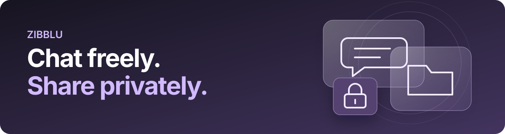
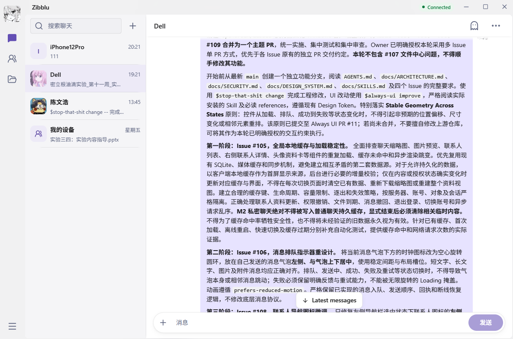
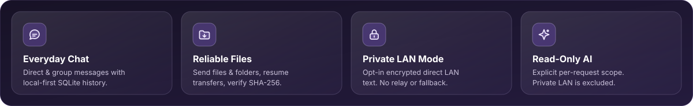
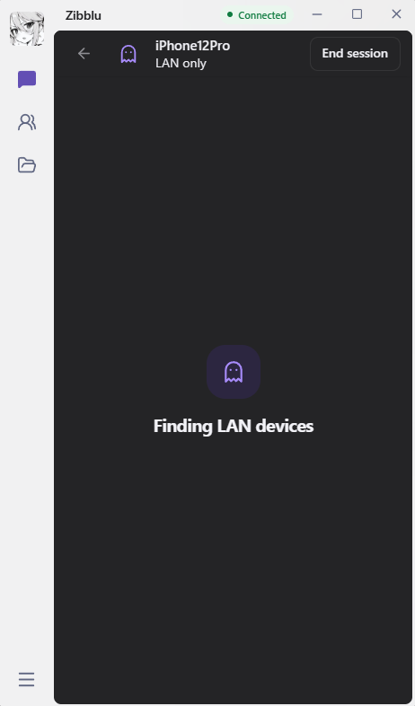
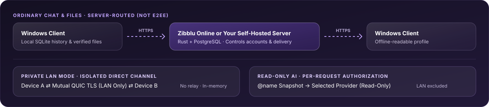
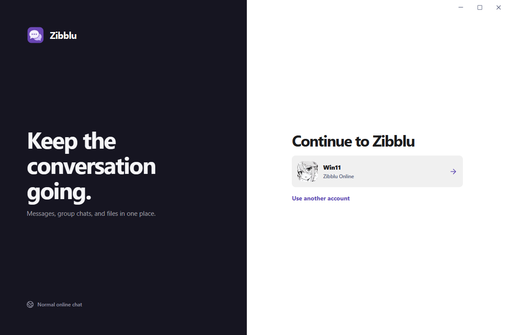

<div align="center">

<a href="https://zibblu.openurain.com/">
  
</a>

<br>

<h1>Zibblu</h1>

<p><strong>A calmer place for conversations, resumable files, and private LAN sessions.</strong></p>

<p>
  <a href="https://github.com/openUrain/Zibblu/releases/tag/v0.1.10"></a>
  
  <a href="LICENSE"></a>
</p>

<p>
  <a href="https://download.openurain.com/zibblu/windows/v0.1.10/Zibblu_0.1.10_x64_Client_Setup.exe"><strong>Download for Windows</strong></a>
  &nbsp;·&nbsp;
  <a href="https://zibblu.openurain.com/">Product Website</a>
  &nbsp;·&nbsp;
  <a href="docs/ONLINE_DEPLOYMENT.md#enterprise-self-hosting">Self-Hosting</a>
  &nbsp;·&nbsp;
  <a href="docs/SECURITY.md">Security Boundaries</a>
  &nbsp;·&nbsp;
  <a href="README.zh-CN.md">简体中文</a>
</p>

</div>

<br>

<p align="center">
  <a href="assets/showcase/02-desktop-chat.png">
    
  </a>
  <br>
  <sub>Windows desktop client · Three-pane conversation workspace · Click to inspect full screenshot</sub>
</p>

<br>

## Built for everyday focus and clear boundaries

<p align="center">
  
</p>

<table>
  <tr>
    <td width="50%" align="center" valign="top">
      <a href="assets/showcase/04-compact-chat.png">
        
      </a>
      <br>
      <sub><strong>Compact layout &amp; read-only AI</strong> — Rich Markdown rendering with explicit per-request <code>@name</code> context selection.</sub>
    </td>
    <td width="50%" align="center" valign="top">
      <a href="assets/showcase/03-private-lan.png">
        
      </a>
      <br>
      <sub><strong>Private LAN mode</strong> — Dedicated dark surface for opt-in, encrypted direct local-network text sessions.</sub>
    </td>
  </tr>
</table>

### Your chats, on your terms

- **Local-first history.** Ordinary messages received by a device are stored in its local SQLite profile, keeping saved conversations readable offline.
- **Resumable, verified file sharing.** Send files and folders, resume interrupted downloads, and verify completed transfers with SHA-256 integrity checks.
- **Private LAN chat.** Start a separate, consent-based, mutual-TLS encrypted text session directly between verified devices on an allowed local network—with no internet relay or silent fallback.
- **Scoped read-only AI.** Mention a configured assistant (`@name`) in an ordinary chat, review the exact messages, optional text files, and provider disclosure for that single request. Assistants cannot modify history or files, and cloud AI has no access to Private LAN sessions.

<br>

## Architecture & privacy boundaries

<p align="center">
  
</p>

> [!IMPORTANT]
> **Privacy, accurately:** Ordinary chats travel through your selected online server (Zibblu Online or your self-hosted instance), which can access messages and attachments during delivery; **ordinary chats are not end-to-end encrypted**. Private LAN text uses a separate direct local-network channel with no internet fallback. Ending a private session clears app-managed in-memory text, but cannot remove screenshots or operating-system traces. See [docs/SECURITY.md](docs/SECURITY.md) for the complete threat model.

<br>

## Get Zibblu for Windows

| Release | Platform | Direct Installer | Verification | Release Notes |
| --- | --- | --- | --- | --- |
| **v0.1.10** | Windows 10 / 11 · x64 | [Zibblu_0.1.10_x64_Client_Setup.exe](https://download.openurain.com/zibblu/windows/v0.1.10/Zibblu_0.1.10_x64_Client_Setup.exe) | [SHA256SUMS.txt](https://download.openurain.com/zibblu/windows/v0.1.10/SHA256SUMS.txt) | [GitHub Release](https://github.com/openUrain/Zibblu/releases/tag/v0.1.10) |

Run the installer, launch Zibblu, and sign in or create an account on **Zibblu Online**. To connect to your own compatible server, choose **Advanced** at sign-in and enter its HTTPS origin. The Windows installer is currently unsigned and may install Microsoft WebView2 when required; verify your download against the published SHA-256 checksum.

<p align="center">
  <a href="assets/showcase/01-sign-in.png">
    
  </a>
  <br>
  <sub>Windows sign-in · Switch accounts or connect directly to a self-hosted server</sub>
</p>

<br>

## Self-hosting

Deploy **Zibblu Online + PostgreSQL** with Docker Compose on infrastructure your organization manages. Clients signed in to your HTTPS server keep ordinary message and file delivery on that infrastructure without routing through the official Zibblu service.

- [**Enterprise Self-Hosting Guide**](docs/ONLINE_DEPLOYMENT.md#enterprise-self-hosting)
- [System Architecture](docs/ARCHITECTURE.md) · [Product Specification](docs/PRODUCT.md) · [Design System](docs/DESIGN_SYSTEM.md)

<br>

## Local development

The desktop client is built with **Tauri 2 · React · TypeScript**; the core library and online service are written in **Rust**, backed by **PostgreSQL** on the server and **SQLite** on clients.

```powershell
# From the repository root, with a local PostgreSQL database:
$env:DATABASE_URL = 'postgres://zibblu:<password>@127.0.0.1:5432/zibblu'
cargo run --locked -p zibblu-online
```

```powershell
# In a separate terminal:
cd apps/desktop
npm ci
npm run tauri dev
```

Requires Rust, Node.js, and the [Tauri prerequisites](https://v2.tauri.app/start/prerequisites/). For builds, local-network setup, and contribution rules, see the [deployment guide](docs/ONLINE_DEPLOYMENT.md), [roadmap](docs/ROADMAP.md), [workflows](.github/workflows), and [AGENTS.md](AGENTS.md).

---

<div align="center">
  <sub>Built by <a href="https://openurain.com/">openUrain</a> &nbsp;·&nbsp; <a href="https://zibblu.openurain.com/">zibblu.openurain.com</a> &nbsp;·&nbsp; <a href="docs/SECURITY.md">Security</a> &nbsp;·&nbsp; <a href="docs/DESIGN_SYSTEM.md">Design System</a></sub>
</div>
