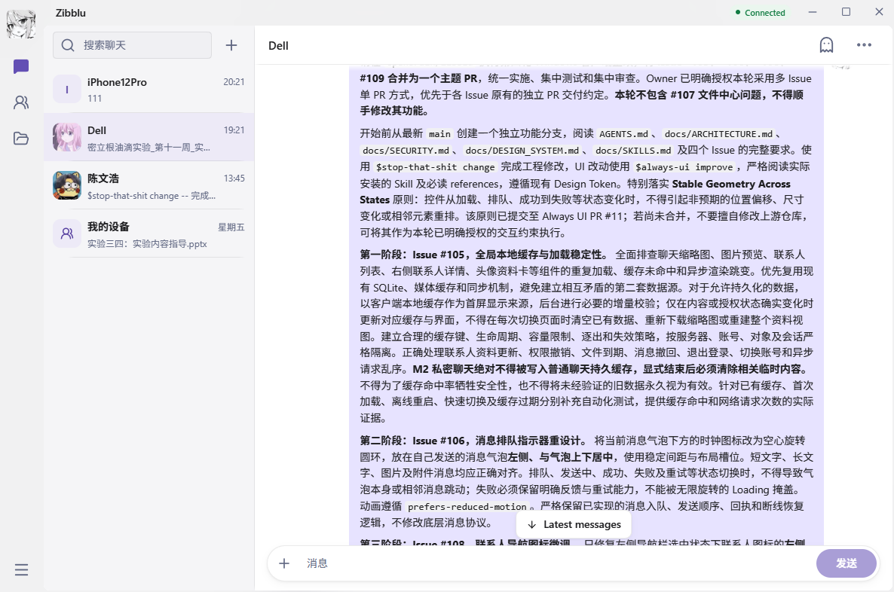
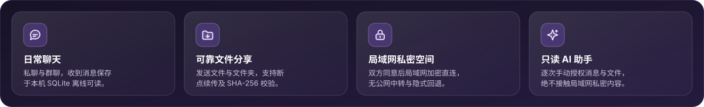
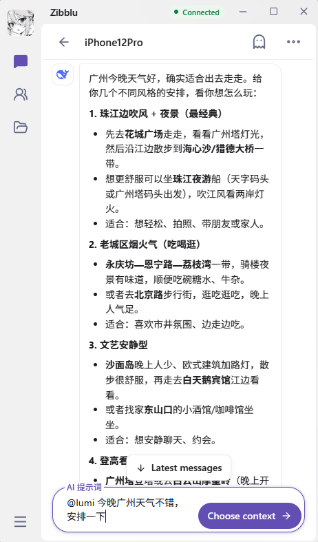
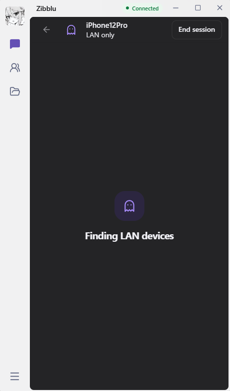
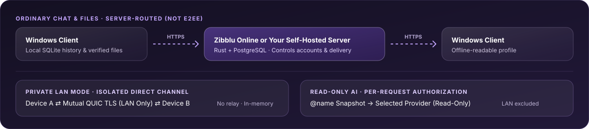
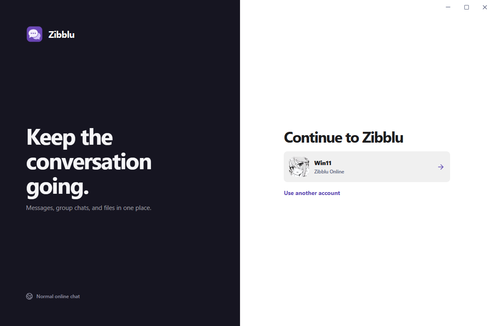

<div align="center">

<a href="https://zibblu.openurain.com/">
  
</a>

<br>

<h1>Zibblu</h1>

<p><strong>让日常聊天、断点续传文件与局域网私密交流，都回归从容与清晰。</strong></p>

<p>
  <a href="https://github.com/openUrain/Zibblu/releases/tag/v0.1.10"></a>
  
  <a href="LICENSE"></a>
</p>

<p>
  <a href="https://download.openurain.com/zibblu/windows/v0.1.10/Zibblu_0.1.10_x64_Client_Setup.exe"><strong>下载 Windows 版</strong></a>
  &nbsp;·&nbsp;
  <a href="https://zibblu.openurain.com/">产品官网</a>
  &nbsp;·&nbsp;
  <a href="docs/ONLINE_DEPLOYMENT.md#enterprise-self-hosting">自建服务器</a>
  &nbsp;·&nbsp;
  <a href="docs/SECURITY.md">安全边界</a>
  &nbsp;·&nbsp;
  <a href="README.md">English</a>
</p>

</div>

<br>

<p align="center">
  <a href="assets/showcase/02-desktop-chat.png">
    
  </a>
  <br>
  <sub>Windows 桌面客户端 · 三栏日常会话界面 · 点击查看原图</sub>
</p>

<br>

## 为专注交流与清晰边界而设计

<p align="center">
  
</p>

<table>
  <tr>
    <td width="50%" align="center" valign="top">
      <a href="assets/showcase/04-compact-chat.png">
        
      </a>
      <br>
      <sub><strong>窄窗口与只读 AI 助手</strong> — 舒适的 Markdown 排版与明确的 <code>@名称</code> 逐次上下文选择入口。</sub>
    </td>
    <td width="50%" align="center" valign="top">
      <a href="assets/showcase/03-private-lan.png">
        
      </a>
      <br>
      <sub><strong>局域网私密模式</strong> — 独立深色界面，在受允许的本地网络中进行双方同意的加密文字直连。</sub>
    </td>
  </tr>
</table>

### 熟悉、轻盈、边界透明

- **Local-First 本地历史**：接收过的普通消息保存在设备本机 SQLite 资料中，离线时依然可以翻阅已有记录。
- **可靠文件分享**：支持文件与文件夹传输、中断恢复以及下载完成后的 SHA-256 完整性校验。
- **局域网私密聊天**：在允许的局域网内，经双方明确同意并与已验证设备建立加密文字直连；不经公网服务器中转，也不做隐式互联网回退。
- **按次授权的只读 AI 助手**：在普通聊天中通过 `@名称` 唤起已配置的助手，逐次勾选本次外发的消息与可选文本文件并确认目标提供商；AI 为严格只读，且绝不接触局域网私密会话内容。

<br>

## 传输架构与隐私边界

<p align="center">
  
</p>

> [!IMPORTANT]
> **如实说明隐私边界**：普通聊天经由所选在线服务器（Zibblu Online 或企业自建服务）投递，服务器在在线投递期间可以访问消息及附件，**普通聊天并非端到端加密**。局域网私密聊天使用独立的设备直连通道，无互联网回退；结束私密会话会清理应用可控的内存正文，但无法消除截图或操作系统层面的痕迹。完整威胁模型请阅读 [docs/SECURITY.md](docs/SECURITY.md)。

<br>

## 下载 Windows 版

| 当前版本 | 适用平台 | 安装包直链 | 校验文件 | 发布说明 |
| --- | --- | --- | --- | --- |
| **v0.1.10** | Windows 10 / 11 · x64 | [Zibblu_0.1.10_x64_Client_Setup.exe](https://download.openurain.com/zibblu/windows/v0.1.10/Zibblu_0.1.10_x64_Client_Setup.exe) | [SHA256SUMS.txt](https://download.openurain.com/zibblu/windows/v0.1.10/SHA256SUMS.txt) | [GitHub Release](https://github.com/openUrain/Zibblu/releases/tag/v0.1.10) |

运行安装程序并打开 Zibblu，即可使用 **Zibblu Online** 登录或注册账号；如需连接团队自建的兼容服务器，请在登录页选择 **Advanced** 并输入对应的 HTTPS 地址。安装包尚未进行代码签名，如设备缺少 Microsoft WebView2，安装程序可能会按需安装它；下载后请务必对照公布的 SHA-256 文件校验完整性。

<p align="center">
  <a href="assets/showcase/01-sign-in.png">
    
  </a>
  <br>
  <sub>Windows 登录入口 · 支持 Zibblu Online 或直接接入自建服务器</sub>
</p>

<br>

## 自建服务器

使用 Docker Compose 在自有基础设施部署 **Zibblu Online + PostgreSQL**，让团队成员连接你托管的 HTTPS 服务完成日常消息与文件投递，不经由官方 Zibblu 服务器中转。

- [**企业自建部署指南**](docs/ONLINE_DEPLOYMENT.md#enterprise-self-hosting)
- [技术架构](docs/ARCHITECTURE.md) · [产品规格](docs/PRODUCT.md) · [设计规范](docs/DESIGN_SYSTEM.md)

<br>

## 本地开发

桌面客户端基于 **Tauri 2 · React · TypeScript**，核心逻辑与在线服务使用 **Rust**；服务端使用 **PostgreSQL**，客户端本地使用 **SQLite**。

```powershell
# 仓库根目录，先准备本地 PostgreSQL 数据库：
$env:DATABASE_URL = 'postgres://zibblu:<password>@127.0.0.1:5432/zibblu'
cargo run --locked -p zibblu-online
```

```powershell
# 另开终端：
cd apps/desktop
npm ci
npm run tauri dev
```

需要安装 Rust、Node.js 及 [Tauri 开发环境](https://v2.tauri.app/start/prerequisites/)。构建步骤、局域网配置与协作约定请参阅 [部署文档](docs/ONLINE_DEPLOYMENT.md)、[开发路线图](docs/ROADMAP.md)、[工作流](.github/workflows) 与 [AGENTS.md](AGENTS.md)。

---

<div align="center">
  <sub>由 <a href="https://openurain.com/">openUrain</a> 打造 &nbsp;·&nbsp; <a href="https://zibblu.openurain.com/">zibblu.openurain.com</a> &nbsp;·&nbsp; <a href="docs/SECURITY.md">安全说明</a> &nbsp;·&nbsp; <a href="docs/DESIGN_SYSTEM.md">设计规范</a></sub>
</div>
